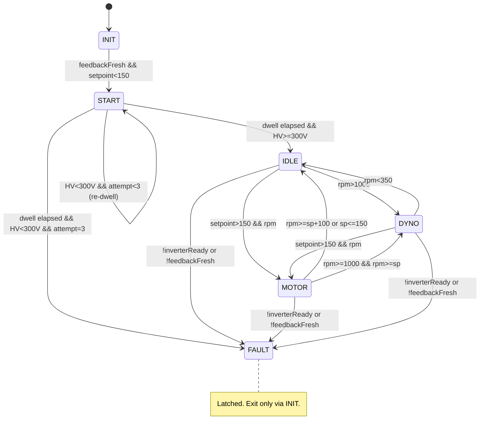

# MetaSense Dyno

MetaSense dyno firmware and web UI for ESP32-S3, built with PlatformIO.

## What This Repo Contains

- Firmware: task-based control, sensor acquisition, safety interlocks, outputs.
- Web UI (LittleFS): live dashboard, settings, trend/report views.
- Persistent settings and run storage.

## Environments

- `esp32s3-USB`: local flashing over USB.
- `esp32s3-ota`: OTA flashing to device on network.

## Quick Start

Build:

```powershell
platformio run -e esp32s3-USB
```

Upload firmware:

```powershell
platformio run -e esp32s3-USB -t upload
```

Upload web UI (LittleFS):

```powershell
platformio run -e esp32s3-USB -t uploadfs
```

OTA equivalents:

```powershell
platformio run -e esp32s3-ota -t upload
platformio run -e esp32s3-ota -t uploadfs
```

## Current Runtime (Important)

- Control loop period: `25 ms` (40 Hz).
- Modbus publisher period: `50 ms`.
- WebSocket telemetry publish limiter: `50 ms`.

Task split:

- Control task: computes telemetry and physical outputs.
- Network task: WebSocket/UI/OTA.
- Modbus task: register publishing.

Physical outputs are updated by control task cadence, not by GUI refresh rate.

## CRC Algorithm Status - ✅ VALIDATED AND WORKING

**Date Resolved**: August 25, 2026  
**Validation**: All 4 known-good Thunderstruck TVCU reference frames match ✅

### Summary

After extensive reverse-engineering, the Nissan Leaf CAN frame CRC algorithms have been definitively identified and validated. Both **0x1DA (RX validation)** and **0x1D4 (TX generation)** use **polynomial 0x85**, but differ in frame ID inclusion and XOR output application.

### 0x1DA (RX Validation from Inverter)

- **Polynomial**: 0x85 (MSB-first)
- **Init**: 0x00
- **XorOut**: 0xBF
- **Input**: `[0xDA, b0, b1, b2, b3, b4, b5, b6]` (frame ID prepended)
- **Status**: ✅ Working, validates all inverter status frames

### 0x1D4 (TX Generation to Inverter) — **CRITICAL FIX**

- **Polynomial**: 0x85 (MSB-first) — same as 0x1DA
- **Init**: 0x00
- **XorOut**: **NONE** (plain output, NOT 0xBF)
- **Input**: `[b0, b1, b2, b3, b4, b5, b6]` — **NO frame ID prepended** (this was the key fix)
- **Payload Structure**:
  - `b0=0x6E` (static)
  - `b1=0x6E` (static)
  - `b2=0x00` (static)
  - `b3=0x00` (static)
  - `b4` = counter (rolling: 0x87→0xC7→0x07→0x47 every 10ms)
  - `b5=0x44` (static charge status)
  - `b6=0x01` (static field)
  - `b7` = calculated CRC
- **Status**: ✅ Working, inverter accepts frames with status "000 000"

### 0x11A (TX Keep-Alive/Echo) — No CRC

- **Byte 1**: 0x40 (corrected from erroneous 0xA0)
- **Byte 6**: Mux selector [0,1,2,3] cycled every frame
- **Byte 7**: Mux-dependent value (0x6B, 0xEE, 0xE4, 0x61)
- **Status**: ✅ Working, cycling correctly with mux

### Reference Frames (Validation Test Set)

All frames captured from Thunderstruck TVCU with inverter connected:

```
Frame 1: 6E 6E 00 00 87 44 01 23  ✅ Counter=0, CRC=0x23 matches
Frame 2: 6E 6E 00 00 C7 44 01 E4  ✅ Counter=1, CRC=0xE4 matches
Frame 3: 6E 6E 00 00 07 44 01 28  ✅ Counter=2, CRC=0x28 matches
Frame 4: 6E 6E 00 00 47 44 01 EF  ✅ Counter=3, CRC=0xEF matches
```

### What Was Wrong Before

The previous implementation used:
- ❌ Polynomial 0x1D29 (completely wrong)
- ❌ Frame ID 0xD4 prepended to 0x1D4 input (wrong)
- ❌ XOR output 0xBF for 0x1D4 (wrong)

Result: Inverter rejected all frames with status "100 000"

### Comprehensive Documentation

See [CRC_ALGORITHM_DEFINITIVE.md](CRC_ALGORITHM_DEFINITIVE.md) for:
- Complete algorithm specification with pseudocode
- C++ implementation details
- Historical investigation notes
- Maintenance guidelines
- Error indicator reference
	- `6E 6E 00 00 07 44 01 [CRC]` (counter=2)
	- `6E 6E 00 00 47 44 01 [CRC]` (counter=3)

`0x11A` note:

- Runtime encoder follows the provided mux/startup layout.
- Byte 7 is startup/mux payload data for selector `m0..m3` (not a CRC byte).

Leaf VCM frame layouts used by the runtime encoder:

- `0x11A`:

```text
BO_ 282 x11A: 8 VCM
 SG_ JoystickGearPosition : 4|4@1+ (1,0) [0|0] "-" Vector__XXX
 SG_ CarOnOffStatus : 13|3@1+ (1,0) [0|0] "-" Vector__XXX
 SG_ Mulitplexor M : 48|8@1+ (1,0) [0|0] "" Vector__XXX
 SG_ StartupDataUnknown0 m0 : 56|8@1+ (1,0) [0|0] "" Vector__XXX
 SG_ StartupDataUnknown1 m1 : 56|8@1+ (1,0) [0|0] "" Vector__XXX
 SG_ StartupDataUnknown2 m2 : 56|8@1+ (1,0) [0|0] "" Vector__XXX
 SG_ StartupDataUnknown3 m3 : 56|8@1+ (1,0) [0|0] "" Vector__XXX
 SG_: 16|8@1+ (1,0) [0|0] "" Vector__XXX
 SG_ HeartbeatVCM : 24|8@1+ (1,0) [85|170] "" Vector__XXX
 SG_ Unknown_11A_4_0 m0 : 32|8@1+ (1,0) [0|0] "" Vector__XXX
 SG_ Unknown_11A_4_1 m1 : 32|8@1+ (1,0) [0|0] "" Vector__XXX
 SG_ Unknown_11A_4_2 m2 : 32|8@1+ (1,0) [0|0] "" Vector__XXX
 SG_ Unknown_11A_4_3 m3 : 32|8@1+ (1,0) [0|0] "" Vector__XXX
 SG_ ECOselected : 12|1@1+ (1,0) [0|0] "" Vector__XXX
```

- `0x1D4`:

```text
BO_ 468 x1D4: 8 VCM
 SG_ MotorAmpTorqueRequest : 23|12@0- (0.25,0) [0|1024] "Nm" Vector__XXX
 SG_ HCM_CLOCK : 38|2@1+ (1,0) [0|3] "-" Vector__XXX
 SG_ StatusOfHighVoltagePowerSupply : 34|1@1+ (1,0) [0|0] "-" Vector__XXX
 SG_ Relay_Plus_Output_Status : 46|1@1+ (1,0) [0|0] "-" Vector__XXX
 SG_ CRC_1D4 : 56|8@1+ (1,0) [0|255] "" Vector__XXX
 SG_ ChargeStatus : 48|8@1+ (1,0) [0|255] "MODEMASK" Vector__XXX
```

Detailed report:

- `docs/CRC_ALGORITHM_REPORT_2026-08-15.md`

## Load-Cell Filtering

Two selectable modes:

- Mode A (`moving_avg`): Stage-1 moving average + alpha stage.
- Mode B (`two_stage_ma`): Stage-1 moving average + Stage-2 moving average.

Window parameters:

- `loadAvgN` = Stage-1 window.
- `loadAvgN2` = Stage-2 window (Mode B only).
- Valid range: `1..48`.

At `T_s = 0.025 s`, two-stage MA delay is approximately:

$$
	au \approx \frac{N_1 + N_2 - 2}{2} \cdot T_s
$$

Example: `N1 = N2 = 48` gives about `1.175 s` filter delay.

## Display vs Telemetry Precision

- Firmware sends high-resolution telemetry (e.g. power/torque/load with finer decimals).
- GUI rounds independently for readability (power and torque shown with 1 decimal).

This keeps charts/storage precise without making the dashboard noisy.

## Safety Notes

- VCU ready (`RB+`) is enforced as a run interlock.
- If interlock drops, runtime moves to safe output state.
- Respect hardware limits and verify wiring before high-load operation.

## Runtime HWSM State Machine

Source of truth: `src/HardwareOutputStateMachine.cpp`.

Primary states:

- `INIT`: precharge ON (SSR + Precharge), RB+/RB- off. Recharges the HV capacitor while waiting for live 0x1DA feedback and a setpoint below `150 RPM`.
- `START`: precharge sequence (see below).
- `IDLE`: HV bus up, precharge held on, RB+ and RB- off unless the RB- latch is engaged.
- `MOTOR`: motor-mode control (PI loop, RPM capped at `motorModeMaxRpm`).
- `DYNO`: dyno-mode control (uncapped setpoint).
- `FAULT`: latched. Reached from `IDLE`, `MOTOR`, or `DYNO` when the inverter reports not-ready or when there is no fresh 0x1DA feedback. Exit only by returning to `INIT`.

Transitions are evaluated on every control update. There is no time-based debounce; the RPM hysteresis bands below are what prevent chatter.

- `INIT` -> `START`: live CAN feedback is fresh and the setpoint is below `150 RPM`.
- `START` -> `IDLE`: the `2500 ms` dwell has elapsed and HV is at least `300 V`.
- `START` -> `START` (retry): the dwell elapsed with HV still below `300 V`. The dwell restarts with precharge still on. This repeats up to `kPrechargeMaxAttempts` (3) dwells in total.
- `START` -> `FAULT`: HV has not reached `300 V` after the last allowed dwell.
- `IDLE` -> `DYNO`: RPM above `1000 RPM`.
- `IDLE` -> `MOTOR`: setpoint above `150 RPM` and RPM below `setpoint + 150` (enter edge).
- `IDLE` -> `DYNO`: RPM above `1000 RPM` and not entering `MOTOR`.
- `MOTOR` -> `DYNO`: setpoint above `150 RPM` is no longer valid or RPM at or above `setpoint + 200`, and RPM is above `1000 RPM`.
- `MOTOR` -> `IDLE`: RPM at or above `setpoint + 200` (or setpoint at or below `150 RPM`) and RPM is not above `1000 RPM`.
- `DYNO` -> `MOTOR`: setpoint above `150 RPM` and RPM below `setpoint + 150` (enter edge).
- `DYNO` -> `IDLE`: RPM below `350 RPM` and not entering `MOTOR`.
- `IDLE`, `MOTOR`, `DYNO` -> `FAULT`: inverter not ready (`leaf_invReady` false), or no fresh 0x1DA feedback within `250 ms`. Inverter status/error bits (`mg_error_codes`) are logged but do not latch FAULT.

RPM hysteresis currently applied:

- Idle/dyno split: `IDLE` -> `DYNO` above `1000 RPM`, `DYNO` -> `IDLE` below `350 RPM`.
- Motor band anchored to the setpoint `S` (applied only when `S > 150 RPM`; this is a validity gate, not a band edge):
	- `MOTOR` is held while `RPM < S + 200` (`kMotorExitOffsetRpm`). Below `S` there is no lower exit edge, so MOTOR keeps driving the engine up to the setpoint.
	- Re-enter `MOTOR` from `IDLE`/`DYNO` only while `RPM < S + 150` (`kMotorExitOffsetRpm` - `kMotorEnterMarginRpm` = 200 - 50).
	- The 50 RPM gap between the enter and exit edges is the hysteresis that prevents chatter.
	- `MOTOR` is never entered from `IDLE`/`DYNO` when `RPM` is above `S + 150`, so an engine coasting above setpoint stays in `IDLE`/`DYNO`.

Setpoint sources:

- The engine-side setpoint is used for all state decisions and PI feedback. It comes from the pot (manual mode) or the stored autorun target.
- In `MOTOR`, the PI setpoint is capped at `motorModeMaxRpm` (default `1500 RPM`). The cap does not affect state transitions, so it cannot cause flapping.
- In `DYNO`, the setpoint is never capped.
- The dyno-side values (CAN `Leaf_RPM`, 0x1D4 torque) are the motor/generator side and differ from engine RPM by the sprocket ratio (11/30 on the current rig).

Precharge sub-flow (`START`):

- Dwell: `2500 ms` per attempt, with precharge relay and SSR on.
- Success: HV at or above `300 V` at the end of a dwell, then `IDLE`.
- Retry: if HV is still below `300 V`, the dwell restarts. Precharge stays on and RB+/RB- stay off. Up to `kPrechargeMaxAttempts` (3) dwells.
- Failure: after the last dwell with HV still below `300 V`, latch `FAULT`.
- There is no auto-completion on timeout or relay dropout.

Continuous precharge in `IDLE`:

- While RB- is off, precharge and SSR are held on in `IDLE`. This keeps the inverter bus charged through a current-limited path. It replaces the former HV keep-alive.
- Rationale: if RB- is on while HV is low, the inverter capacitor can discharge into the load-dump resistor, which drops HV and can trip the inverter (status `0x18`).
- The RB- latch engages at `1000 RPM` or above and releases below `900 RPM` (engine-side RPM).
- RB+ is held on together with precharge once precharge has succeeded, so `IDLE`, `MOTOR` and `DYNO` transitions do not drop RB+.

Relay intent by state (firmware output mapping, in RB+ / RB- / SSR / Precharge order):

- `INIT`: SSR + Precharge ON, RB+/RB- off (same pattern as `START`).
- `START`: RB+ off, RB- off, SSR on, precharge on.
- `IDLE`, RB- off: RB+ on, RB- off, SSR on, precharge on.
- `IDLE`, RB- latched: RB+ on, RB- on, SSR off, precharge off.
- `MOTOR`: RB+ on, RB- off, SSR on, precharge on (forced on by SSR).
- `DYNO`: RB+ on, RB- on, SSR off, precharge off.
- `FAULT`: SSR and precharge off, RB+/RB- frozen. A recording stop (`stop()`) does not clear a latched FAULT.

Mermaid overview:



## Useful Files

- `src/main.cpp`: task scheduling, startup, web server routes.
- `src/Input.cpp`: sensor pipeline, filters, control-side telemetry flow.
- `src/CANBus.cpp`: CAN RX/TX, wire-level 0x1DA CRC verification.
- `src/Settings.cpp`: persisted settings and validation.
- `src/CommandRouter.cpp`: WebSocket command handling and settings API.
- `include/LeafCrc.h`: global single-source CRC implementation used by runtime CRC checks/generation.
- `data/index.html`: main dashboard UI.
- `data/settings.html`: settings UI.
- `docs/NISSAN_LEAF_1DA_CRC.md`: Nissan-compatible 0x1DA CRC algorithm and residue tables.
- `docs/CRC_ALGORITHM_REPORT_2026-08-15.md`: implementation report, capture findings, and validation status.

## Typical Dev Loop

1. Edit firmware (`src/**`) and/or UI (`data/**`).
2. Build and upload firmware when C++ changed.
3. Upload LittleFS when HTML/JS/CSS changed.
4. Verify behavior on dashboard and on physical outputs.

## Git Hygiene

Before committing:

```powershell
git status --short
```

Recommended split commits:

- firmware logic
- web UI
- docs

- Adjust Kp via Pot3 in small increments while monitoring overshoot and settling.
- Tune Ki in settings only after Kp behavior is stable.
- Re-test interlock behavior after each significant tuning change.