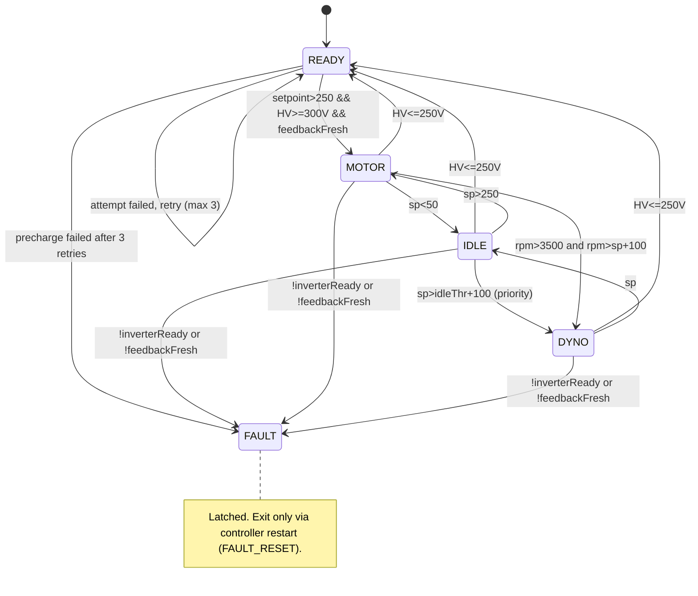

# MetaSense Dyno

MetaSense dyno firmware and web UI for ESP32-S3, built with PlatformIO.

## What This Repo Contains

- Firmware: task-based control, sensor acquisition, safety interlocks, outputs.
- Web UI (LittleFS): live dashboard, settings, trend/report views.
- Persistent settings and run storage.

## Environments

- `esp32s3-USB`: local flashing over USB.
- `esp32s3-ota`: OTA flashing to device on network.

## Quick Start

Build:

```powershell
platformio run -e esp32s3-USB
```

Upload firmware:

```powershell
platformio run -e esp32s3-USB -t upload
```

Upload web UI (LittleFS):

```powershell
platformio run -e esp32s3-USB -t uploadfs
```

OTA equivalents:

```powershell
platformio run -e esp32s3-ota -t upload
platformio run -e esp32s3-ota -t uploadfs
```

## Current Runtime (Important)

- Control loop period: `25 ms` (40 Hz).
- Modbus publisher period: `50 ms`.
- WebSocket telemetry publish limiter: `50 ms`.

Task split:

- Control task: computes telemetry and physical outputs.
- Network task: WebSocket/UI/OTA.
- Modbus task: register publishing.

Physical outputs are updated by control task cadence, not by GUI refresh rate.

## CRC Algorithm Status - ✅ VALIDATED AND WORKING

**Date Resolved**: August 25, 2026  
**Validation**: All 4 known-good Thunderstruck TVCU reference frames match ✅

### Summary

After extensive reverse-engineering, the Nissan Leaf CAN frame CRC algorithms have been definitively identified and validated. Both **0x1DA (RX validation)** and **0x1D4 (TX generation)** use **polynomial 0x85**, but differ in frame ID inclusion and XOR output application.

### 0x1DA (RX Validation from Inverter)

- **Polynomial**: 0x85 (MSB-first)
- **Init**: 0x00
- **XorOut**: 0xBF
- **Input**: `[0xDA, b0, b1, b2, b3, b4, b5, b6]` (frame ID prepended)
- **Status**: ✅ Working, validates all inverter status frames

### 0x1D4 (TX Generation to Inverter) — **CRITICAL FIX**

- **Polynomial**: 0x85 (MSB-first) — same as 0x1DA
- **Init**: 0x00
- **XorOut**: **NONE** (plain output, NOT 0xBF)
- **Input**: `[b0, b1, b2, b3, b4, b5, b6]` — **NO frame ID prepended** (this was the key fix)
- **Payload Structure**:
  - `b0=0x6E` (static)
  - `b1=0x6E` (static)
  - `b2=0x00` (static)
  - `b3=0x00` (static)
  - `b4` = counter (rolling: 0x87→0xC7→0x07→0x47 every 10ms)
  - `b5=0x44` (static charge status)
  - `b6=0x01` (static field)
  - `b7` = calculated CRC
- **Status**: ✅ Working, inverter accepts frames with status "000 000"

### 0x11A (TX Keep-Alive/Echo) — No CRC

- **Byte 1**: 0x40 (corrected from erroneous 0xA0)
- **Byte 6**: Mux selector [0,1,2,3] cycled every frame
- **Byte 7**: Mux-dependent value (0x6B, 0xEE, 0xE4, 0x61)
- **Status**: ✅ Working, cycling correctly with mux

### Reference Frames (Validation Test Set)

All frames captured from Thunderstruck TVCU with inverter connected:

```
Frame 1: 6E 6E 00 00 87 44 01 23  ✅ Counter=0, CRC=0x23 matches
Frame 2: 6E 6E 00 00 C7 44 01 E4  ✅ Counter=1, CRC=0xE4 matches
Frame 3: 6E 6E 00 00 07 44 01 28  ✅ Counter=2, CRC=0x28 matches
Frame 4: 6E 6E 00 00 47 44 01 EF  ✅ Counter=3, CRC=0xEF matches
```

### What Was Wrong Before

The previous implementation used:
- ❌ Polynomial 0x1D29 (completely wrong)
- ❌ Frame ID 0xD4 prepended to 0x1D4 input (wrong)
- ❌ XOR output 0xBF for 0x1D4 (wrong)

Result: Inverter rejected all frames with status "100 000"

### Comprehensive Documentation

See [CRC_ALGORITHM_DEFINITIVE.md](CRC_ALGORITHM_DEFINITIVE.md) for:
- Complete algorithm specification with pseudocode
- C++ implementation details
- Historical investigation notes
- Maintenance guidelines
- Error indicator reference
	- `6E 6E 00 00 07 44 01 [CRC]` (counter=2)
	- `6E 6E 00 00 47 44 01 [CRC]` (counter=3)

`0x11A` note:

- Runtime encoder follows the provided mux/startup layout.
- Byte 7 is startup/mux payload data for selector `m0..m3` (not a CRC byte).

Leaf VCM frame layouts used by the runtime encoder:

- `0x11A`:

```text
BO_ 282 x11A: 8 VCM
 SG_ JoystickGearPosition : 4|4@1+ (1,0) [0|0] "-" Vector__XXX
 SG_ CarOnOffStatus : 13|3@1+ (1,0) [0|0] "-" Vector__XXX
 SG_ Mulitplexor M : 48|8@1+ (1,0) [0|0] "" Vector__XXX
 SG_ StartupDataUnknown0 m0 : 56|8@1+ (1,0) [0|0] "" Vector__XXX
 SG_ StartupDataUnknown1 m1 : 56|8@1+ (1,0) [0|0] "" Vector__XXX
 SG_ StartupDataUnknown2 m2 : 56|8@1+ (1,0) [0|0] "" Vector__XXX
 SG_ StartupDataUnknown3 m3 : 56|8@1+ (1,0) [0|0] "" Vector__XXX
 SG_: 16|8@1+ (1,0) [0|0] "" Vector__XXX
 SG_ HeartbeatVCM : 24|8@1+ (1,0) [85|170] "" Vector__XXX
 SG_ Unknown_11A_4_0 m0 : 32|8@1+ (1,0) [0|0] "" Vector__XXX
 SG_ Unknown_11A_4_1 m1 : 32|8@1+ (1,0) [0|0] "" Vector__XXX
 SG_ Unknown_11A_4_2 m2 : 32|8@1+ (1,0) [0|0] "" Vector__XXX
 SG_ Unknown_11A_4_3 m3 : 32|8@1+ (1,0) [0|0] "" Vector__XXX
 SG_ ECOselected : 12|1@1+ (1,0) [0|0] "" Vector__XXX
```

- `0x1D4`:

```text
BO_ 468 x1D4: 8 VCM
 SG_ MotorAmpTorqueRequest : 23|12@0- (0.25,0) [0|1024] "Nm" Vector__XXX
 SG_ HCM_CLOCK : 38|2@1+ (1,0) [0|3] "-" Vector__XXX
 SG_ StatusOfHighVoltagePowerSupply : 34|1@1+ (1,0) [0|0] "-" Vector__XXX
 SG_ Relay_Plus_Output_Status : 46|1@1+ (1,0) [0|0] "-" Vector__XXX
 SG_ CRC_1D4 : 56|8@1+ (1,0) [0|255] "" Vector__XXX
 SG_ ChargeStatus : 48|8@1+ (1,0) [0|255] "MODEMASK" Vector__XXX
```

Detailed report:

- `docs/CRC_ALGORITHM_REPORT_2026-08-15.md`

## Load-Cell Filtering

Two selectable modes:

- Mode A (`moving_avg`): Stage-1 moving average + alpha stage.
- Mode B (`two_stage_ma`): Stage-1 moving average + Stage-2 moving average.

Window parameters:

- `loadAvgN` = Stage-1 window.
- `loadAvgN2` = Stage-2 window (Mode B only).
- Valid range: `1..48`.

At `T_s = 0.025 s`, two-stage MA delay is approximately:

$$
	au \approx \frac{N_1 + N_2 - 2}{2} \cdot T_s
$$

Example: `N1 = N2 = 48` gives about `1.175 s` filter delay.

## Display vs Telemetry Precision

- Firmware sends high-resolution telemetry (e.g. power/torque/load with finer decimals).
- GUI rounds independently for readability (power and torque shown with 1 decimal).

This keeps charts/storage precise without making the dashboard noisy.

## WebSocket Telemetry Back-Pressure

Telemetry is split into two `data` frames sent to each WebSocket client:

- Fast frame (live gauges and charts: RPM, torque, kW, peaks, throttle, leaf torque/RPM, mode and state flags) every `METASENSE_WS_FAST_PERIOD_MS` (33 ms). While the CAN monitor is open, `leaf_1da_torque_nm` and `leaf_1da_clock` are added here too.
- Slow frame (digital displays and CAN/status: energy, climate, EGT, lambda, massflow, load, relay states, `leaf_1da_rpm`, `leaf_1da_err`, coolant, setpoints) every `METASENSE_WS_SLOW_PERIOD_MS` (100 ms).

The client merges partial frames into its cached state. ESPAsyncWebServer queues up to 32 outgoing messages per client. When that queue overflows, the library drops the TCP connection without a WebSocket close frame. Browsers see close code 1006 and reconnect, which showed up as frequent reconnects on weak Wi-Fi links (about -75 dBm RSSI).

`src/Input.cpp` now applies back-pressure per client:

- If a client's queue holds at least `kWebSocketSkipQueueLen` (1) messages, the telemetry frame is skipped for that client. The connection stays open and catches up as its queue drains.
- `src/WebSocketServer.cpp` logs `[WS] Client error` for `WS_EVT_ERROR` events, and `[WS] Client disconnected` with the connection lifetime and queued message count.
- `data/index.html` logs the close code, `wasClean`, lifetime, and time since the last message to the browser console on every socket close.

Only the skipped frames are lost, so a congested link shows as a short gap in the timestamps rather than a reconnect. A test build without the skip check was tried and reconnects returned, so the check stays.

Result: connections that previously lasted about 4 s now stay up for minutes. The latest test ran more than 500 s with no reconnects at threshold 1 on a weak link (about -73 dBm RSSI).

## Safety Notes

- Run gating uses inverter liveness, CAN readiness and inverter fault status. The former VCU-ready RB+ interlock has been removed.
- If a safety gate drops, runtime moves to safe output state.
- Respect hardware limits and verify wiring before high-load operation.

## Runtime HWSM State Machine

Source of truth: `src/HardwareOutputStateMachine.cpp`.

Primary states:

- `READY`: precharge ON (InverterPrecharge), RB+/RB-/MotorPower (SSR) off. Holds here until the setpoint is above `250 RPM` (150 + H, H = 100 RPM). Recharges the HV capacitor, and goes to `MOTOR` once the setpoint is above `250 RPM` and HV is at or above `300 V`, after a 2 s attempt. An attempt that ends below `300 V` is retried up to 3 times, then `FAULT`.
- `IDLE`: HV bus up. RB- follows the setpoint with hysteresis (setting `idleThresholdRpm`, default `2000 RPM`, H = 100 RPM): on (precharge off) when the setpoint is above `idleThresholdRpm + H`, off (precharge on) when it is below `idleThresholdRpm - H`, and unchanged inside the band. Freewheel with 0 Nm torque, no braking. Precharge stays on so HV is held up while RB- is off, avoiding any braking. Returns to `READY` if HV drops to `250 V` or below.
- `MOTOR`: motor-mode control (PI loop). The PI tracking setpoint is limited to `motorModeMaxRpm` (a setpoint limit, not an engine RPM limit). Precharge on. Returns to `READY` if HV drops to `250 V` or below.
- `DYNO`: dyno-mode control (uncapped setpoint). Precharge off (RB- is on). Returns to `READY` if HV drops to `250 V` or below.
- `FAULT`: latched. Reached from `IDLE`, `MOTOR`, or `DYNO` when the inverter reports not-ready or when there is no fresh 0x1DA feedback. Also reached from `READY` when precharge fails: HV stays below `300 V` after the first attempt and 3 retries. Exit only by restarting the controller (`FAULT_RESET`, or a reboot).

Transitions are evaluated on every control update. There is no time-based debounce; the RPM hysteresis bands below are what prevent chatter.

- `READY` -> `READY` (hold): setpoint is at or below `250 RPM`. Precharge stays on and the machine does not discharge HV by cycling to `IDLE`.
- `READY` -> `MOTOR`: setpoint is above `250 RPM` (150 + H), live CAN feedback is fresh, HV is at least `300 V`, the 2 s precharge attempt has elapsed, and the boot gate is open.
- Boot gate: after power-up, the setpoint must be seen at `0 RPM` once before `READY` can go operative. The latch then stays open until the next reboot, so a later setpoint change never blocks it.
- `IDLE` -> `DYNO`: setpoint above `idleThresholdRpm + 100 RPM` (default `2100 RPM`). This takes priority over `MOTOR`.
- `IDLE` -> `MOTOR`: setpoint above `250 RPM` (150 + H).
- `MOTOR` -> `IDLE`: setpoint below `50 RPM` (150 - H).
- `MOTOR` -> `DYNO`: engine RPM above `3500 RPM` and above `setpoint + 100 RPM`.
- `DYNO` -> `IDLE`: setpoint below `idleThresholdRpm - 100 RPM` (default `1900 RPM`). From `IDLE`, the setpoint then decides whether to enter `MOTOR`, so `DYNO` -> `MOTOR` passes through `IDLE`.
- `IDLE`, `MOTOR`, `DYNO` -> `READY`: HV is at or below `250 V` (for example at 0 RPM with no generator EMF). Precharge stays on in `READY` until the `READY` -> `MOTOR` conditions are met.
- `IDLE`, `MOTOR`, `DYNO` -> `FAULT`: inverter not ready (`leaf_invReady` false), or no fresh 0x1DA feedback within `250 ms`. Inverter status/error bits (`mg_error_codes`) are logged but do not latch FAULT.

RPM hysteresis currently applied (H = 100 RPM, constants `kSetpointCentreRpm`, `kSetpointHystRpm`, `kEngineHystRpm`):

- Setpoint: MOTOR is entered above `150 + H` (250 RPM) and left below `150 - H` (50 RPM). Setpoints between 50 and 250 RPM do not change MOTOR's state.
- Engine RPM vs setpoint `S`: `MOTOR` enters `DYNO` above `S + H`. `S` is the requested setpoint clamped to `motorModeMaxRpm + 1000 RPM`. `IDLE` enters `DYNO` when `S` is above `idleThresholdRpm + H` and leaves when `S` is below `idleThresholdRpm - H`. The IDLE/DYNO comparisons use the setpoint, not engine RPM, because engine RPM overshoots under PI control.

Setpoint sources:

- The engine-side setpoint is used for all state decisions and PI feedback. It comes from the pot (manual mode) or the stored autorun target.
- In `MOTOR`, the PI tracking setpoint is limited to `motorModeMaxRpm` (setting; firmware default `2000 RPM`). The state machine also clamps the setpoint to `motorModeMaxRpm + 1000 RPM` for state decisions, so a setpoint above that cannot hold `MOTOR` or `DYNO`.
- In `DYNO`, the setpoint is never capped.
- The dyno-side values (CAN `Leaf_RPM`, 0x1D4 torque) are the motor/generator side and differ from engine RPM by the sprocket ratio (11/30 on the current rig).

Precharge sub-flow (`READY`):

- Precharge output (GPIO38, independent precharge SSR and rectifier) is on for the whole of `READY`. SSR and RB+/RB- stay off.
- Retry: an attempt that ends with HV below `300 V` is retried after 2 s, up to 3 times. After the third retry fails, the machine goes to `FAULT`. `READY` holds while the setpoint is at or below `250 RPM`, and goes to `MOTOR` once the setpoint is above `250 RPM`, HV is at or above `300 V`, and the 2 s attempt has elapsed.
- There is no auto-completion on timeout or relay dropout. Precharge is not released by a timer.

Grid connection in `IDLE` and `DYNO`:

- RB- closes in `DYNO`, and in `IDLE` once the setpoint is above `idleThresholdRpm + H` (it opens again below `idleThresholdRpm - H`). It connects the 12.5 Ω load-dump resistor.
- RB+ (grid inverter main power) closes in `DYNO` when HV rises above `320 V`, and opens when HV falls below `300 V` (20 V hysteresis, `kGridRbPlusCloseHvV` / `kGridRbPlusOpenHvV`). Between 300 and 320 V it holds its state. It is open in `IDLE`. With RB+ on, the grid inverter is in parallel with the load-dump resistor, so DYNO power is dissipated in either or both, depending on which are connected.
- Precharge is mutually exclusive with RB-. It is on whenever RB- is off (`READY`, `MOTOR`, and `IDLE` with RB- off) and off whenever RB- is on (`IDLE` with RB- on, `DYNO`). `FAULT` releases it too. A precharge/RB- swap uses the 20 ms break-before-make dwell. At or below `250 V` in `IDLE`, `DYNO` or `MOTOR`, the machine returns to `READY`, where precharge stays on.

Relay intent by state (firmware output mapping, in RB+ / RB- / SSR / Precharge order):

- `READY`: RB+ off, RB- off, SSR off, precharge on.
- `IDLE`: RB+ off, SSR off. RB- on with precharge off when the setpoint is above `idleThresholdRpm + H`; RB- off with precharge on when it is below `idleThresholdRpm - H`; held inside the band.
- `DYNO`: RB+ on while HV > 320 V (off below 300 V, held in between), RB- on, SSR off, precharge off.
- `MOTOR`: RB+ off, RB- off, SSR on, precharge on. SSR is the motor-only power path.
- `FAULT`: all relays off, including SSR, RB- and RB+ (precharge also released). FAULT latches until a restart. A recording stop (`stop()`) does not clear it.

SSR is mutually exclusive with RB- and RB+. Any swap goes through the 20 ms break-before-make step.

Torque demand and PI control by state:

- `IDLE`: PI control is off (reset and held at zero). The 0x1D4 torque request is 0 Nm (freewheel, no braking). The IDLE/DYNO threshold is the `idleThresholdRpm` setting (Settings > IDLE Threshold).
- `MOTOR` and `DYNO`: PI control is active. The torque command, PI output limits and the manual demand are limited to +/- `brakeMaxTorqueNm` (default 30 Nm, Settings > Brake Max Torque).

0x1D4 bit 46 (`Relay_Plus_Output_Status`) is held at 1 in all states. Driving it from the relay state would drop it for 20 ms during break-before-make.

Mermaid overview:



## Useful Files

- `src/main.cpp`: task scheduling, startup, web server routes.
- `src/Input.cpp`: sensor pipeline, filters, control-side telemetry flow.
- `src/CANBus.cpp`: CAN RX/TX, wire-level 0x1DA CRC verification.
- `src/Settings.cpp`: persisted settings and validation.
- `src/CommandRouter.cpp`: WebSocket command handling and settings API.
- `include/LeafCrc.h`: global single-source CRC implementation used by runtime CRC checks/generation.
- `data/index.html`: main dashboard UI.
- `data/settings.html`: settings UI.
- `docs/NISSAN_LEAF_1DA_CRC.md`: Nissan-compatible 0x1DA CRC algorithm and residue tables.
- `docs/CRC_ALGORITHM_REPORT_2026-08-15.md`: implementation report, capture findings, and validation status.

## Typical Dev Loop

1. Edit firmware (`src/**`) and/or UI (`data/**`).
2. Build and upload firmware when C++ changed.
3. Upload LittleFS when HTML/JS/CSS changed.
4. Verify behavior on dashboard and on physical outputs.

## Git Hygiene

Before committing:

```powershell
git status --short commit 14-11-2026 ccf092a
15-11-2026 4cff461 on main
I committed the watchdog as ac92ae4 on main. 
```

Recommended split commits:

- firmware logic
- web UI
- docs

- Adjust Kp in settings in small increments while monitoring overshoot and settling.
- Tune Ki in settings only after Kp behavior is stable.
- Re-test interlock behavior after each significant tuning change.